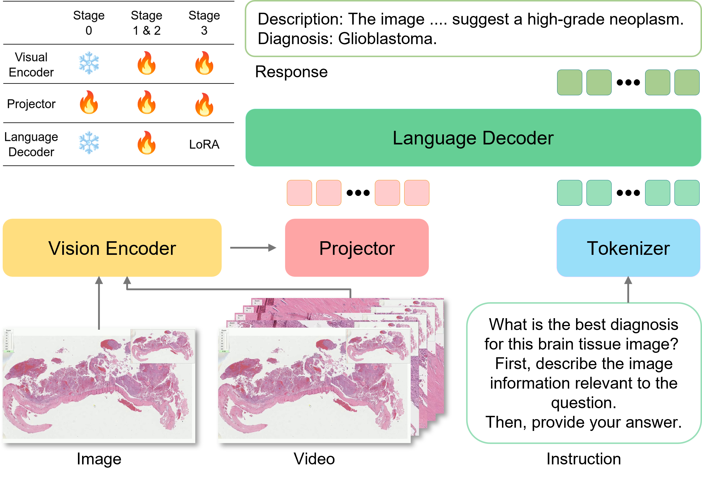

# 🧬 ViDRiP-LLaVA: A Dataset and Benchmark for Diagnostic Reasoning from Pathology Videos

**ViDRiP-LLaVA** is a vision-language framework designed for instruction-based diagnostic reasoning using both image patches and video clips from pathology slides. It builds on LLaVA and extends it to the medical domain with domain-specific datasets and fine-tuned models.


🧠 Introducing our ViDRiP-LLaVA: the first multimodal model for diagnostic reasoning in pathology through video-based instruction. 🔬📽️

Our method leverages chain-of-thought (CoT) prompting to distill the reasoning capabilities of LLMs. ViDRiP-LLaVA generates both detailed histological descriptions and final diagnoses, simulating how pathologists analyze and sign out cases.

📚 Trained on 4,278 instructional video pairs

⚙️ Combines single-image + clip transfer and fine-tuning on segmented diagnostic videos


---
<p align="center" width="100%">

</p>


## 📚 Video Datasets

### 🎥 Released Video Format

All clips are:
- **Cleaned** using a Visual Data Refinement pipeline (temporal trimming + YoloPath filtering + OCR exclusion + inpainting)
- **Downsampled** to **1–5 FPS** to reduce file size and support fair-use compliance
- **Muted** to avoid redistribution of original YouTube audio

These steps preserve diagnostic signal while respecting the rights of YouTube creators and complying with [YouTube’s Terms of Service](https://www.youtube.com/t/terms).

### 🔍 Training vs. Public Release Notice
The ViDRiP-LLaVA models were trained on an internal dataset version that included:
- Full-frame-rate video clips
- Visual content **prior to OCR filtering**

All **evaluations** (including those in our benchmark) are conducted using the **publicly released test set**, ensuring full reproducibility.


### 🔹 [ViDRiP_Instruct_Train](https://huggingface.co/datasets/trinhvg/ViDRiP_Instruct_Train)
The videos data is ~ 60 GB:

[//]: # (### 🔹 [ViDRiP_Instruct_Train_Video_GoogleDrive]&#40;https://drive.google.com/drive/folders/1oxZlaJpE7PGDYt32LeoGgIzwEvWdnupY?usp=sharing&#41;)
### 🔹 [ViDRiP_Instruct_Train_Video_Hugging Face](https://huggingface.co/datasets/trinhvg/ViDRiP_Instruct_Train) (There is 6 zip files)

- 4,000+ instruction-style samples
- Each sample includes:
  - A pathology video clip
  - A diagnostic question
  - A multi-turn reasoning answer
- Format: JSON + MP4
- Croissant-compliant metadata for structured use

### 🔹 [ViDRiP_Instruct_Test](https://huggingface.co/datasets/trinhvg/ViDRiP_Instruct_Test)
### 🔹 [ViDRiP_Instruct_Test_Video](https://drive.google.com/drive/folders/1oxZlaJpE7PGDYt32LeoGgIzwEvWdnupY?usp=sharing)

- Held-out test set of diagnostic Q&A pairs
- Used for benchmarking reasoning performance


## 📚 Image Datasets
We use publicly available datasets: Quilt-LLaVA and PathAsst.
Please refer to their respective repositories for download instructions.
- [**Quilt-LLaVA**](https://github.com/aldraus/quilt-llava): A vision-language dataset for pathology adapted from LLaVA.
- [**PathAsst**](https://github.com/superjamessyx/Generative-Foundation-AI-Assistant-for-Pathology): A generative assistant for pathology with curated image-text pairs.


---

## 🤖 Models

Two SigLIP-based checkpoints are released (SigLIP image encoder + Qwen2.5-7B decoder, LLaVA-OneVision architecture):

| Checkpoint | Training stages | Best for |
|---|---|---|
| 🔸 [ViDRiP-LLaVA-SigLIP](https://huggingface.co/trinhvg/ViDRiP-LLaVA-SigLIP) | 0 and 1, ClipDesc, then ViDRiP-Instruct | Open-ended diagnostic descriptions |
| 🔸 [ViDRiP-LLaVA-SigLIP-wo-ClipDesc](https://huggingface.co/trinhvg/ViDRiP-LLaVA-SigLIP-wo-ClipDesc) | 0 and 1, then ViDRiP-Instruct | Multiple-choice questions |

These repositories were previously named `trinhvg/ViDRiP_LLaVA_video` and `trinhvg/ViDRiP_LLaVA_image`.

**Note:** the CONCH- and MUSK-based ViDRiP-LLaVA weights are not released. They contain fine-tuned copies of the CONCH v1.5 and MUSK encoders, whose licenses (CC BY-NC-ND 4.0) do not permit redistribution of derivatives. They can be reproduced with the released training code and instruction data by researchers who obtain the encoders from their licensors.


## 🚀 Quickstart

### 🔧 Fine-tuning the model on video dataset
```bash
./scripts/train/finetune_ov_video.sh
```

### 🪄 Fine-tuning with LoRA
```bash
./scripts/train/finetune_ov_video_lora.sh
```
🔗 Merge LoRA weights
```bash
./scripts/train/merge_lora_weights.py
```
### 🧪 Usage / Demo
```bash
./doc/ViDRiP_LLaVA_trial.py
```


### 🔧 Evaluate on our video dataset

We use [lmms_eval](https://github.com/EvolvingLMMs-Lab/lmms-eval) to evaluate the performance of video diagnostic reasoning.

To benchmark `ViDRiP-LLaVA` and compare it with other models:

1. Clone the `lmms_eval` repo
2. Copy our evaluation task folder into it:

```bash
cp -r lmms_eval/tasks/ViDRiP_Instruct_Test /path/to/lmms_eval/tasks/
```
You can then run evaluation using the standard lmms_eval CLI interface.


### Citation:
Coming soon


## 📄 Usage and License Notices

**ViDRiP-LLaVA** (Vision-language Diagnostic Reasoning in Pathology), including its dataset, code, and model checkpoints, is released strictly for **non-commercial research purposes only**.

### 📁 Licenses

* **Dataset:**
  Licensed under [**CC BY-NC-ND 3.0**](https://creativecommons.org/licenses/by-nc-nd/3.0/) (Attribution–NonCommercial–NoDerivatives)
* **Code and pretrained models:**
  Licensed under [**CC BY-NC 3.0**](https://creativecommons.org/licenses/by-nc/3.0/) (Attribution–NonCommercial)

### ⚙️ Dependencies and Components

This project may incorporate or build upon resources such as **LLaVA-Next**, **QUILT-1M**, **LLaMA**, **PathAsst**, and **GPT-4**, each subject to their own licenses and **Terms of Use**.

### 🎥 Source Acknowledgment

ViDRiP-LLaVA includes data derived from **public educational pathology videos hosted on YouTube**.
All content usage complies with [**YouTube’s Terms of Service**](https://www.youtube.com/t/terms), and the **intellectual property rights of the original pathologist creators are fully acknowledged and respected**.

### 🚫 Restrictions

* Not for **commercial use**
* Not to be used in **clinical care** or **medical decision-making**
* For **academic research, development, and evaluation only**
