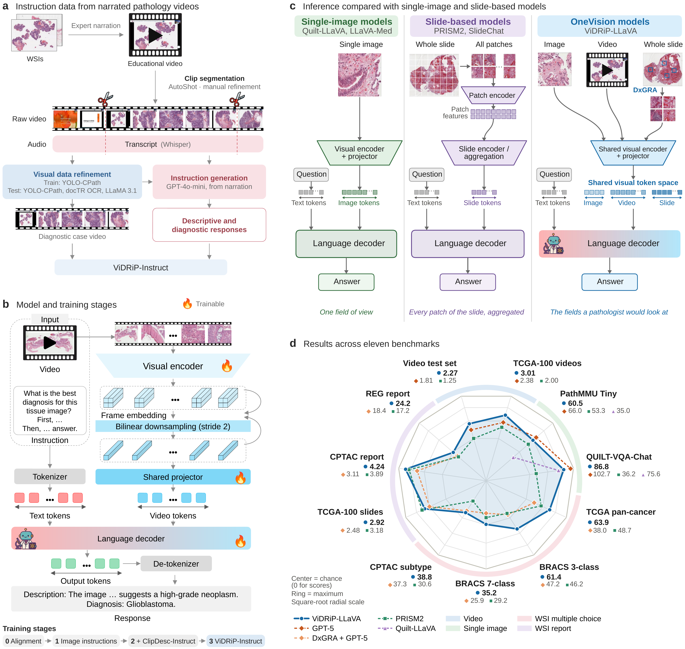

<p align="center">
  
</p>

<h1 align="center">ViDRiP-LLaVA</h1>

<p align="center">
  <b>Learning diagnostic reasoning from narrated pathology videos for images, videos and whole slides</b>
</p>

<p align="center">
  <a href="https://huggingface.co/trinhvg/ViDRiP-LLaVA-SigLIP"></a>
  <a href="https://huggingface.co/trinhvg/ViDRiP-LLaVA-SigLIP-wo-ClipDesc"></a>
  <a href="https://huggingface.co/datasets/trinhvg/ViDRiP_Instruct_Train"></a>
  <a href="https://creativecommons.org/licenses/by-nc/3.0/"></a>
</p>

<p align="center">
  <a href="#-models">Models</a> ·
  <a href="#-data">Data</a> ·
  <a href="#-quick-start">Quick start</a> ·
  <a href="#-citation">Citation</a> ·
  <a href="#-license-and-intended-use">License</a>
</p>

ViDRiP-LLaVA is a pathology vision–language model that learns from narrated educational pathology videos.
It describes what it sees in a pathology image or video clip and gives a diagnosis, the way a pathologist talks through a case.

- **Two instruction datasets** built from 5,796 educational YouTube videos:
  - **ClipDesc-Instruct**: 139,941 descriptive clips (661 h) from 4,223 YouTube videos
  - **ViDRiP-Instruct**: 4,036 manually curated videos (239 h) from 3,194 YouTube videos, each following a case from tissue findings to a diagnosis
  - **Video test set**: 502 videos (28 h) from 214 YouTube videos, held out from training
- **Curriculum training**: image–text alignment, image instruction tuning, ClipDesc-Instruct, then ViDRiP-Instruct
- **One model for images, videos and whole slides**: single images and frame sequences directly; whole-slide images through a retrieval agent (DxGRA)

<p align="center">
  
</p>

---

## 🤖 Models

<table>
  <tr><th align="left">Model</th><th align="left">Training stages</th><th align="left">Best for</th></tr>
  <tr>
    <td nowrap><a href="https://huggingface.co/trinhvg/ViDRiP-LLaVA-SigLIP"><b>ViDRiP-LLaVA-SigLIP</b></a></td>
    <td nowrap>0 → 1 → ClipDesc → ViDRiP-Instruct</td>
    <td nowrap>Open-ended diagnostic descriptions</td>
  </tr>
  <tr>
    <td nowrap><a href="https://huggingface.co/trinhvg/ViDRiP-LLaVA-SigLIP-wo-ClipDesc"><b>ViDRiP-LLaVA-SigLIP-wo-ClipDesc</b></a></td>
    <td nowrap>0 → 1 → ViDRiP-Instruct</td>
    <td nowrap>Multiple-choice questions</td>
  </tr>
</table>

Both use the SigLIP image encoder and a Qwen2.5-7B language decoder (LLaVA-OneVision architecture).

> CONCH- and MUSK-based weights are not released: their encoder licences (CC BY-NC-ND 4.0) do not allow redistribution.
> They can be reproduced with the training code and data here, using encoders obtained from their licensors.

---

## 📚 Data

### ViDRiP-Instruct (video)

<table>
  <tr><th align="left">Split</th><th align="left">Content</th><th align="left">Link</th></tr>
  <tr>
    <td nowrap>Train</td>
    <td>4,036 instruction–response pairs (JSON) + videos (~60 GB, 6 zip parts)</td>
    <td nowrap><a href="https://huggingface.co/datasets/trinhvg/ViDRiP_Instruct_Train">🤗 trinhvg/ViDRiP_Instruct_Train</a></td>
  </tr>
</table>

Each sample has a pathology video clip, a diagnostic question, and an answer that links the morphology to a diagnosis.

**Released video format.** All clips are cleaned (temporal trimming, YoloPath tissue filtering, OCR text exclusion and inpainting),
downsampled to 1–5 FPS and muted, to respect the rights of the original creators and [YouTube's Terms of Service](https://www.youtube.com/t/terms).

**Training vs. released data.** The models were trained on an internal version of the clips at full frame rate and before OCR filtering.
The 502-video benchmark used in the paper is held out and available on request.

### Image data

Image stages use public datasets; please download them from their own repositories:
[Quilt-LLaVA](https://github.com/aldraus/quilt-llava) and [PathAsst](https://github.com/superjamessyx/Generative-Foundation-AI-Assistant-for-Pathology).

---

## 🚀 Quick start

### Install

```bash
git clone https://github.com/trinhvg/ViDRiP-LLaVA.git
cd ViDRiP-LLaVA
pip install -e ".[train]"
```

### Inference

```python
from llava.model.builder import load_pretrained_model

tokenizer, model, image_processor, max_length = load_pretrained_model(
    "trinhvg/ViDRiP-LLaVA-SigLIP", None, "llava_qwen", device_map="auto", attn_implementation="sdpa"
)
```

A complete image/video example (32 uniformly sampled frames) is in [`docs/VidDiag_LLaVA_trial.py`](docs/VidDiag_LLaVA_trial.py).

### Training

```bash
# Fine-tune on the video data (full)
bash scripts/train/finetune_ov_video.sh

# Fine-tune with LoRA, then merge the LoRA weights
bash scripts/train/finetune_ov_video_lora.sh
python scripts/train/merge_lora_weights.py
```

### Evaluation

Video diagnosis is evaluated with [lmms-eval](https://github.com/EvolvingLMMs-Lab/lmms-eval). Copy our task into your lmms-eval clone and run it with the standard CLI (the held-out benchmark videos are available on request):

```bash
cp -r lmms_eval/tasks/VidDiag_Instruct_Test /path/to/lmms-eval/lmms_eval/tasks/
```

---

## 📝 Citation

Coming soon.

---

## 📄 License and intended use

| Component | License |
|:--|:--|
| Code and model weights | [CC BY-NC 3.0](https://creativecommons.org/licenses/by-nc/3.0/) |
| Dataset | [CC BY-NC-ND 3.0](https://creativecommons.org/licenses/by-nc-nd/3.0/) |

- **Non-commercial research only.**
- **Not for clinical use** or medical decision-making.
- Builds on LLaVA-NeXT, Qwen2.5, SigLIP, Quilt-1M, PathAsst and GPT-4-family models, each under its own license and terms of use.

The data are derived from public educational pathology videos on YouTube. The intellectual property of the original pathologist creators is fully acknowledged.

## 🙏 Acknowledgements

This code builds on [LLaVA-NeXT](https://github.com/LLaVA-VL/LLaVA-NeXT) and [lmms-eval](https://github.com/EvolvingLMMs-Lab/lmms-eval).
We thank the pathologists who share their teaching videos publicly.
